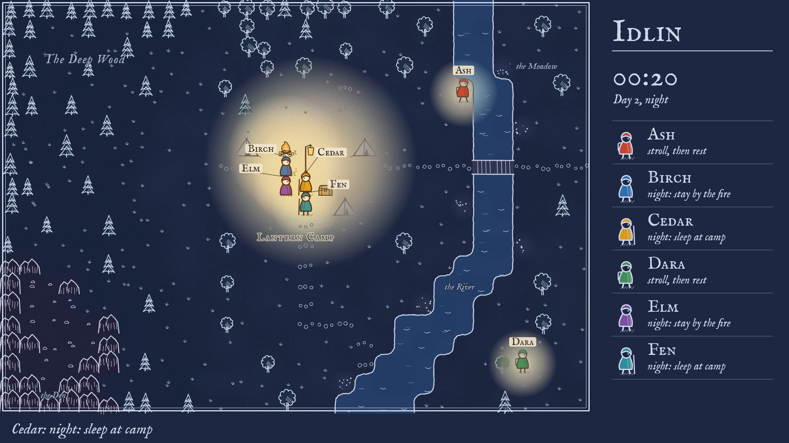
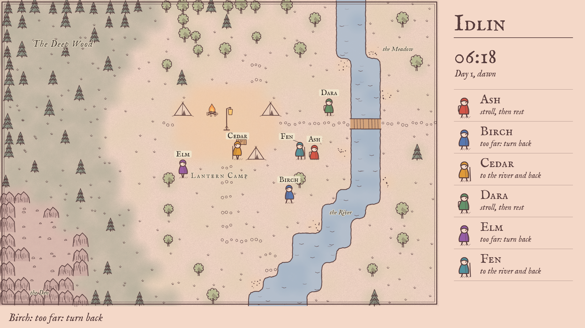
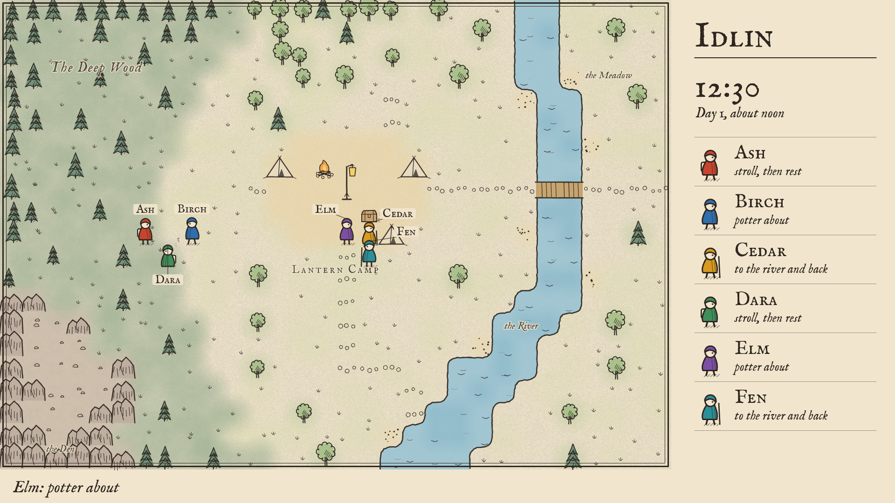
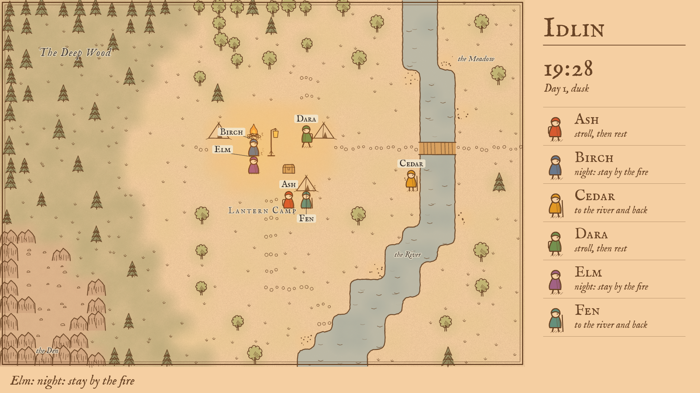

# Idlin

Idlin is an idle RPG built to run unattended on a livestream. Nobody plays it
directly. Each character is driven by a small script running in a sandboxed VM,
and monsters will work the same way. The plan is that viewers get to write the
scripts.

It's early. There's one map, six characters walking around, and a day/night
cycle. Combat, skills and loot don't exist yet; [docs/roadmap.md](docs/roadmap.md)
has the order they're planned in.



More screenshots, at 06:15, 12:30 and 19:12 game time:

|                                                                                 |                                                                                 |                                                                                 |
| ------------------------------------------------------------------------------- | ------------------------------------------------------------------------------- | ------------------------------------------------------------------------------- |
|  |  |  |

The screenshots are taken from the running game by `tools/capture` and get
replaced when the game changes, so they should match what's on `main`.

## Running it

You need Docker. Nothing else gets installed on your machine.

```sh
docker compose run --rm dev pnpm install
docker compose up client          # http://localhost:4310
```

`?hour=21` in the URL starts at a different time of day and `?seed=7` gives a
different world.

To run the checks CI runs (lint, typecheck, tests):

```sh
docker compose run --rm dev pnpm gate
```

## Docs

- [docs/design.md](docs/design.md): what the game is meant to be
- [docs/roadmap.md](docs/roadmap.md): what's planned, in order
- [docs/stack.md](docs/stack.md): what it's built with and how to run things
- [AGENTS.md](AGENTS.md): most of this repo is written by AI agents working
  from the issue tracker, and this is the process they follow

The art is Kenney's Tiny Town and Tiny Dungeon packs (CC0); see
[assets/CREDITS.md](assets/CREDITS.md).

An older, unrelated version of the game is on the branch
`archive/idlin-pre-2.0-2026-09-02`.
