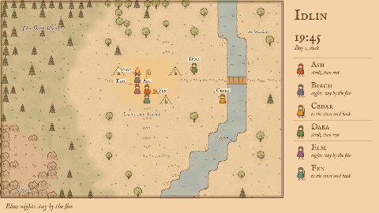
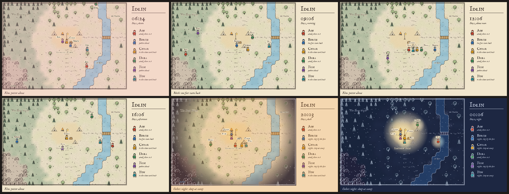

# Idlin

Idlin is an idle RPG built to run unattended on a livestream. Nobody plays it
directly. Each character is driven by a small script running in a sandboxed
VM, and monsters work the same way. The plan is that viewers get to write
the scripts.

It's early. The world is four regions, six characters and a day/night cycle.
The camp's region holds the lantern, the wood, the river, the den and the
meadow, and a pinewood, hills and a lower river lie past its edges. The
viewer shows one region at a time, the one the spotlit character is in, and
pans slowly to the next when the spotlight moves; a small map on the page
shows all four and where everyone is. The characters run one of three scripts from
`content/bots/`, which tell them where to walk, when to go back to camp, and
how to fight. Wolves and goblins
(`content/monsters/`) fight them in the simulation, and the viewer draws the
fights, both in the world server's world and in a world of its own opened with
`?monsters`. The scripting language is described in
[docs/tactics.md](docs/tactics.md). Fighting earns Melee and Hitpoints
experience, each character has a bag and a bank, and the page beside the map
shows hitpoints and skill levels. Gathering, cooking and loot don't exist yet;
[docs/roadmap.md](docs/roadmap.md) has the order they're planned in.

The game is being rebuilt around a walking city with a horde behind it: a
machine on legs that sets down on blank paper every 20 minutes, has its
residents draw the map as they go out, and leaves when the horde arrives.
None of that is built yet. [docs/plan.md](docs/plan.md) has the plan.




Dawn, noon and dusk:

|                                                                                 |                                                                                 |                                                                                 |
| ------------------------------------------------------------------------------- | ------------------------------------------------------------------------------- | ------------------------------------------------------------------------------- |
|  |  |  |

Two minutes around nightfall, one frame every ten seconds:


And six moments across a day:



All of these are taken from the running game by `tools/capture` and are
refreshed from `main`, so they should be close to what you get if you run it.

## Running it

You need Docker. Everything else runs in containers.

```sh
docker compose run --rm dev pnpm install
docker compose up server client   # http://localhost:4310
```

The viewer shows the world the server is running; the server keeps it in
`data/` across restarts. `?seed=7` in the URL instead runs a world of seed 7 in
the page, and `?hour=21` starts that one at a different time of day.

To run the checks CI runs (lint, typecheck, tests):

```sh
docker compose run --rm dev pnpm gate
```

## Docs

- [docs/design.md](docs/design.md): what the game is meant to be
- [docs/art.md](docs/art.md): how it is meant to be drawn, and how much of it is
- [docs/roadmap.md](docs/roadmap.md): what's planned, in order
- [docs/tactics.md](docs/tactics.md): the scripting language
- [docs/stack.md](docs/stack.md): what it's built with and how to run things
- [AGENTS.md](AGENTS.md): most of this repo is written by AI agents working
  from the issue tracker, and this is the process they follow

The map and characters are drawn in code; there are no art assets. The
typeface is IM Fell English (SIL Open Font License); see
[assets/CREDITS.md](assets/CREDITS.md).

An earlier codebase for Idlin is on the branch
`archive/idlin-pre-2.0-2026-09-02`.
