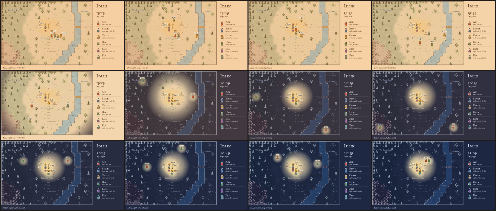

# Idlin

Idlin is an idle RPG built to run unattended on a livestream. Nobody plays it
directly. The streamer's city is a machine on legs that walks from landing to
landing, every chatter is a citizen aboard it named by their username, and
each citizen is driven by a small script running in a sandboxed VM. Chat
steers a citizen by changing what its script reads.

It's early, and it is being rebuilt as the slice in
[docs/slice.md](docs/slice.md): one cycle of the walking city at the quality
of a finished game. What runs today is the city's deck and its cycle: a
13-minute loop of transit, the landing set down at 3:00, the peace, the
horde's beats, the siege and lift-off, with a generated landing to walk on
each time. Chatters join aboard and run the shipped script, Deckhand
(`content/bots/`), which walks about the landing and comes home before the
lift. The landing has no monsters, loot or shield yet, and the viewer draws
the ground as flat tiles and the citizens as dots until the look target
([#362](https://github.com/nnamon/Idlin/issues/362)) is drawn in.
[docs/roadmap.md](docs/roadmap.md) has the order the rest comes in, and the
scripting language is described in [docs/tactics.md](docs/tactics.md).

A frame from each beat of the first cycle, with the 15-chatter crowd aboard:



|                                                                                       |                                                                                       |                                                                                   |
| ------------------------------------------------------------------------------------- | ------------------------------------------------------------------------------------- | --------------------------------------------------------------------------------- |
|  |  |  |

All of these are taken from the running game by `tools/capture` and are
refreshed from `main`, so they should be close to what you get if you run it.

## Running it

You need Docker. Everything else runs in containers.

```sh
docker compose run --rm dev pnpm install
docker compose up server client   # http://localhost:4310
```

The viewer shows the city the server is running; the server keeps it in
`data/` across restarts. With no chat the city walks its cycle with nobody
aboard: `IDLIN_CHAT=crowd:crowd-15` gives it a scripted crowd. `?chat=crowd-15`
in the URL instead runs a city of the page's own with that crowd aboard,
`?seed=7` another seed, and `?tick=1800` starts it at that tick.

To run the checks CI runs (lint, typecheck, tests):

```sh
docker compose run --rm dev pnpm gate
```

## Docs

- [docs/design.md](docs/design.md): what the game is meant to be
- [docs/art.md](docs/art.md): how it is meant to be drawn, and how much of it is
- [docs/roadmap.md](docs/roadmap.md): what's planned, in order
- [docs/tactics.md](docs/tactics.md): the scripting language
- [docs/stack.md](docs/stack.md): what it's built with and how to run things
- [AGENTS.md](AGENTS.md): most of this repo is written by AI agents working
  from the issue tracker, and this is the process they follow

The game is drawn in code; there are no art assets. The
typeface is IM Fell English (SIL Open Font License); see
[assets/CREDITS.md](assets/CREDITS.md).

An earlier codebase for Idlin is on the branch
`archive/idlin-pre-2.0-2026-09-02`.
